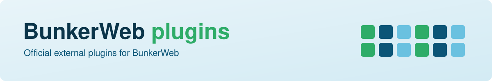

	

	
	 
	
	
	
	 
	
	
	 
	
	

	<picture>
		<source media="(prefers-color-scheme: dark)" srcset=".github/assets/banner-dark.svg" />
		<source media="(prefers-color-scheme: light)" srcset=".github/assets/banner-light.svg" />
		
	</picture>

Official external plugins for [BunkerWeb](https://github.com/bunkerity/bunkerweb): add authentication, security scanning, WAF inspection, notifications, and edge integrations. New to BunkerWeb? Start with the [documentation](https://docs.bunkerweb.io/?utm_campaign=self&utm_source=github).

<table align="center">
<tr>
<td align="center" width="20%"> <a href="#security-scanning"><b>Security scanning</b></a> ClamAV · VirusTotal · SentinelOne</td>
<td align="center" width="20%"> <a href="#web-application-firewall"><b>Web application firewall</b></a> Coraza · open-appsec</td>
<td align="center" width="20%"> <a href="#authentication"><b>Authentication</b></a> Authentik</td>
<td align="center" width="20%"> <a href="#notifications"><b>Notifications</b></a> Discord · Matrix · Slack · WebHook</td>
<td align="center" width="20%"> <a href="#edge-and-network"><b>Edge and network</b></a> Cloudflare · SysWarden</td>
</tr>
</table>

# Plugins

Choose a plugin below. Each link opens its directory; the README there covers prerequisites, setup, settings, and troubleshooting.

## Security scanning

Inspect uploaded files and client IPs, and deny what the scanner flags.

| Plugin                                                                              | What it does                                                                                                             |
| ----------------------------------------------------------------------------------- | ------------------------------------------------------------------------------------------------------------------------ |
| [ClamAV](https://github.com/bunkerity/bunkerweb-plugins/tree/main/clamav)           | Scans multipart file uploads with a ClamAV `clamd` daemon and denies the request when a file is flagged as infected.     |
| [VirusTotal](https://github.com/bunkerity/bunkerweb-plugins/tree/main/virustotal)   | Checks client IPs and the SHA-256 of uploaded files against the VirusTotal API v3 and denies over-threshold results.     |
| [SentinelOne](https://github.com/bunkerity/bunkerweb-plugins/tree/main/sentinelone) | Checks client IPs and uploaded-file SHA-1 hashes against your SentinelOne Singularity console, denying flagged requests. |

## Web application firewall

Block malicious requests before they reach the upstream.

| Plugin                                                                             | What it does                                                                                                                      |
| ---------------------------------------------------------------------------------- | --------------------------------------------------------------------------------------------------------------------------------- |
| [Coraza](https://github.com/bunkerity/bunkerweb-plugins/tree/main/coraza)          | Runs the Coraza web application firewall with the OWASP Core Rule Set to block malicious requests before they reach the upstream. |
| [open-appsec](https://github.com/bunkerity/bunkerweb-plugins/tree/main/openappsec) | Lets BunkerWeb consult open-appsec, Check Point's open-source machine-learning WAF, before a request reaches the upstream.        |

## Authentication

Put a login in front of any site.

| Plugin                                                                          | What it does                                                                         |
| ------------------------------------------------------------------------------- | ------------------------------------------------------------------------------------ |
| [Authentik](https://github.com/bunkerity/bunkerweb-plugins/tree/main/authentik) | Forward authentication with Authentik, on top of any existing service configuration. |

## Notifications

Get an alert each time BunkerWeb denies a request. These plugins send notifications asynchronously; they never block traffic.

| Plugin                                                                      | What it does                                                                                 |
| --------------------------------------------------------------------------- | -------------------------------------------------------------------------------------------- |
| [Discord](https://github.com/bunkerity/bunkerweb-plugins/tree/main/discord) | Sends an attack notification to a Discord channel through a webhook.                         |
| [Matrix](https://github.com/bunkerity/bunkerweb-plugins/tree/main/matrix)   | Sends an attack notification to a Matrix room each time BunkerWeb denies a request.          |
| [Slack](https://github.com/bunkerity/bunkerweb-plugins/tree/main/slack)     | Posts a Slack message to an incoming webhook each time BunkerWeb denies a request.           |
| [WebHook](https://github.com/bunkerity/bunkerweb-plugins/tree/main/webhook) | Posts an attack notification to a custom HTTP endpoint each time BunkerWeb denies a request. |

## Edge and network

Sit BunkerWeb behind Cloudflare, or pair its bans with the host firewall.

| Plugin                                                                            | What it does                                                                                                                                        |
| --------------------------------------------------------------------------------- | --------------------------------------------------------------------------------------------------------------------------------------------------- |
| [Cloudflare](https://github.com/bunkerity/bunkerweb-plugins/tree/main/cloudflare) | Makes BunkerWeb a first-class origin behind Cloudflare: real client IP, trusted-peer checks, Authenticated Origin Pulls and Origin CA certificates. |
| [SysWarden](https://github.com/bunkerity/bunkerweb-plugins/tree/main/syswarden)   | Turns BunkerWeb Layer 7 bans into kernel-level nftables drops with SysWarden, and denies SysWarden's blocklist at Layer 7.                          |

# Install

Follow the [external plugin installation guide](https://docs.bunkerweb.io/latest/plugins/?utm_campaign=self&utm_source=github), then follow the selected plugin's README for prerequisites and configuration.

# Compatibility and releases

> Release **1.14** supports **BunkerWeb 1.6.17**.

The compatibility declaration applies to all 12 plugins listed above. Historical declarations are preserved in
[COMPATIBILITY.json](COMPATIBILITY.json); older BunkerWeb versions have not been
revalidated for 1.14.

To prepare a release, run `bash misc/update_version.sh <version>` from the repository
root and add the matching version to `COMPATIBILITY.json`, listing the BunkerWeb
versions validated by the integration suite. CI checks that every plugin uses the
same version and that its compatibility entry includes the resolved BunkerWeb tag.

After `Tests` succeeds on `main`, a maintainer creates and pushes a signed annotated
tag matching the plugin version (for example, `v1.14`). The signing key must be
registered with the maintainer's GitHub account so GitHub can verify the signature.
CI holds no private signing key.

The tag push triggers the release workflow. It requires the tag to match the version
and current `main` commit, a verified signature targeting that commit, and a successful
`Tests` push run on `main` for that exact commit. Lightweight, unsigned, and mismatched
tags are rejected. An existing release or draft is left alone; otherwise the workflow
creates a draft with generated release notes for a maintainer to review and publish.

# Support

## Professional

Get technical support, tailored consulting, and custom development directly from the BunkerWeb maintainers through the [BunkerWeb panel](https://panel.bunkerweb.io/?utm_campaign=self&utm_source=github).

The panel also offers:

- [BunkerWeb PRO](https://panel.bunkerweb.io/store/bunkerweb-pro?utm_campaign=self&utm_source=github), with a 30-day free trial.
- [BunkerWeb Cloud](https://panel.bunkerweb.io/store/bunkerweb-cloud?utm_campaign=self&utm_source=github), a fully managed BunkerWeb instance with PRO features, monitoring dashboards and alerts, and technical support.

## Community

For free community support, use:

- The #help channel in the [BunkerWeb Discord server](https://bunkerity.discord.com/?utm_campaign=self&utm_source=github)
- The help category of [GitHub discussions](https://github.com/bunkerity/bunkerweb-plugins/discussions)
- The [/r/BunkerWeb](https://www.reddit.com/r/BunkerWeb) subreddit
- The [Server Fault](https://serverfault.com/) and [Super User](https://superuser.com/) forums

Use [GitHub issues](https://github.com/bunkerity/bunkerweb-plugins/issues) for bug reports, feature requests, and new plugin proposals. Check existing issues first; use the community channels above for help.

# License

This project is licensed under the terms of the [GNU Affero General Public License (AGPL) version 3](https://github.com/bunkerity/bunkerweb-plugins/tree/main/LICENSE.md).

# Contribute

Read the [contributing guidelines](https://github.com/bunkerity/bunkerweb-plugins/tree/main/CONTRIBUTING.md) before submitting a pull request. For non-trivial changes, open an issue first to discuss the approach.

# Security policy

Report vulnerabilities privately to security \[@\] bunkerity.com, following the [security policy](https://github.com/bunkerity/bunkerweb-plugins/tree/main/SECURITY.md).
