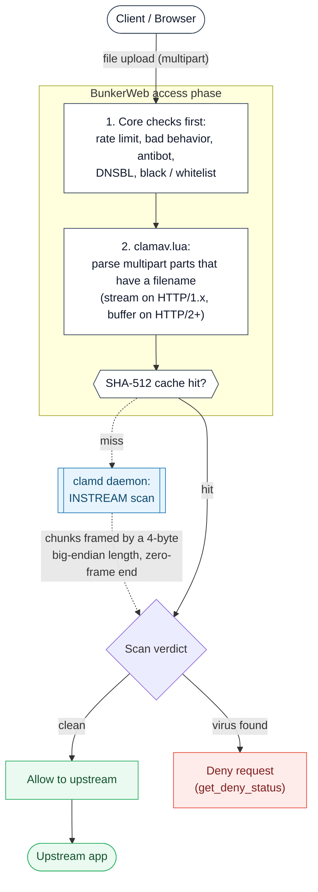

# ClamAV plugin




This [plugin](https://www.bunkerweb.io/latest/plugins/?utm_campaign=self&utm_source=github)
streams every uploaded file to a [ClamAV](https://www.clamav.net/) `clamd`
daemon and denies the request when the antivirus engine flags a file as
infected. It works on top of any existing service configuration - reverse
proxy, served files, custom location blocks - without replacing them.

The scan runs from Lua during BunkerWeb's access phase, so all of BunkerWeb's
built-in checks (rate limit, bad behavior, antibot, DNSBL, whitelist /
blacklist, ...) run _before_ any file is handed to `clamd`. Files are streamed
to `clamd` over its binary INSTREAM protocol on a TCP socket - not HTTP. At
worker startup the plugin pings `clamd` to verify connectivity, and it exposes
a `POST /clamav/ping` health endpoint used by the BunkerWeb web UI.

# Table of contents

- [ClamAV plugin](#clamav-plugin)
- [Table of contents](#table-of-contents)
- [How it works](#how-it-works)
- [Prerequisites](#prerequisites)
- [Setup](#setup)
  - [Docker](#docker)
  - [Swarm](#swarm)
  - [Kubernetes](#kubernetes)
  - [Several clamd nodes](#several-clamd-nodes)
- [Settings](#settings)
- [Troubleshooting](#troubleshooting)
- [Notes](#notes)

# How it works

For a `multipart/form-data` upload to a protected site:

1. BunkerWeb's access-phase checks run first (rate limit, bad behavior,
   antibot, DNSBL, blacklist, ...). If any of them deny, the request stops
   here and `clamd` is never contacted.
2. `clamav.lua` runs. It only acts on `multipart/form-data` requests with a
   boundary; any other request (plain `POST`, JSON, GET, ...) is passed
   through untouched.
3. The handler reads the request body and inspects each part, scanning **only**
   the parts that carry a real filename in their `Content-Disposition` header -
   quoted (`filename="x"`), unquoted (`filename=x`) and RFC 5987 extended
   (`filename*=...`) forms are all recognized. Form fields without a filename are
   skipped. Over **HTTP/1.x** the body is streamed part-by-part with
   `resty.upload`; over **HTTP/2 / HTTP/3** - where the raw request socket
   `resty.upload` relies on is unavailable - the body is buffered (in memory, or
   nginx's temp file for large uploads) and its multipart parts are parsed before
   scanning. The same files reach `clamd` either way.
4. As each scanned file is read, its bytes are forwarded to the `clamd` daemon
   over the binary INSTREAM protocol on a TCP socket (each chunk framed by a
   4-byte big-endian length prefix) while a SHA-512 checksum is computed.
5. When the part ends, the checksum is looked up in BunkerWeb's shared cache. On
   a **hit** the socket is closed without finalizing the scan and the cached
   verdict is reused. On a **miss** a zero-length frame terminates the stream,
   `clamd` returns its verdict on that line, and the result is cached for 24h.
6. **Clean** - the request continues to its normal destination (reverse proxy,
   file serving, custom location). **Detection** - the request is denied with
   BunkerWeb's deny status; the file's checksum and the matched signature name
   are written to the log.

# Prerequisites

Please read the [plugins section](https://docs.bunkerweb.io/latest/plugins/?utm_campaign=self&utm_source=github)
of the BunkerWeb documentation first.

You need a reachable `clamd` instance. The official `clamav/clamav` image
exposes `clamd` on TCP port `3310` and ships `freshclam` to keep the signature
database up to date; BunkerWeb only needs network access to that port.

# Setup

See the [plugins section](https://docs.bunkerweb.io/latest/plugins/?utm_campaign=self&utm_source=github)
of the BunkerWeb documentation for the generic installation procedure depending
on your integration (the short version: drop the `clamav/` directory into the
scheduler's `/data/plugins/` and restart).

`CLAMAV_HOST` / `CLAMAV_PORT` are the address BunkerWeb uses to reach `clamd` -
typically an internal Docker network address. They are **global** settings, so
one ClamAV backend serves every site; `USE_CLAMAV` is **multisite**, so you
enable scanning per service.

## Docker

```yaml
services:

  bunkerweb:
    image: bunkerity/bunkerweb:1.6.11
    ...
    networks:
      - bw-plugins
    ...

  bw-scheduler:
    image: bunkerity/bunkerweb-scheduler:1.6.11
    ...
    environment:
      USE_CLAMAV: "yes"
      CLAMAV_HOST: "clamav"
    ...

  clamav:
    image: clamav/clamav:1.4
    volumes:
      - ./clamav-data:/var/lib/clamav
    networks:
      - bw-plugins

networks:
  # BunkerWeb networks
  ...
  bw-plugins:
    name: bw-plugins
```

## Swarm

```yaml
services:

  bunkerweb:
    image: bunkerity/bunkerweb:1.6.11
    ...
    networks:
      - bw-plugins
    ...

  bw-scheduler:
    image: bunkerity/bunkerweb-scheduler:1.6.11
    ...
    environment:
      USE_CLAMAV: "yes"
      CLAMAV_HOST: "clamav"
    ...

  clamav:
    image: clamav/clamav:1.4
    networks:
      - bw-plugins

networks:
  # BunkerWeb networks
  ...
  bw-plugins:
    driver: overlay
    attachable: true
    name: bw-plugins
...
```

## Kubernetes

First you will need to deploy the ClamAV dependency:

```yaml
apiVersion: apps/v1
kind: Deployment
metadata:
  name: bunkerweb-clamav
spec:
  replicas: 1
  selector:
    matchLabels:
      app: bunkerweb-clamav
  template:
    metadata:
      labels:
        app: bunkerweb-clamav
    spec:
      containers:
        - name: bunkerweb-clamav
          image: clamav/clamav:1.4
---
apiVersion: v1
kind: Service
metadata:
  name: svc-bunkerweb-clamav
spec:
  selector:
    app: bunkerweb-clamav
  ports:
    - protocol: TCP
      port: 3310
      targetPort: 3310
```

Then you can configure the plugin:

```yaml
apiVersion: networking.k8s.io/v1
kind: Ingress
metadata:
  name: ingress
  annotations:
    bunkerweb.io/USE_CLAMAV: "yes"
    bunkerweb.io/CLAMAV_HOST: "svc-bunkerweb-clamav.default.svc.cluster.local"
```

## Several clamd nodes

With a high volume of uploads you can spread the scans over several `clamd`
nodes. The plugin has no node list: it connects to `CLAMAV_HOST` once per
scanned file, so the only requirement is a name that resolves to every node.

Validated on **Docker Compose** with BunkerWeb 1.6.17, two `clamav/clamav:1.4`
nodes, and Docker's built-in DNS round-robin (replicas of one service share the
service name). Swarm, Kubernetes and external load balancers were **not**
tested.

```yaml
services:

  bw-scheduler:
    image: bunkerity/bunkerweb-scheduler:1.6.11
    ...
    environment:
      USE_CLAMAV: "yes"
      CLAMAV_HOST: "clamav"
    ...

  # The only container that runs freshclam
  clamav-updater:
    image: clamav/clamav:1.4
    environment:
      CLAMAV_NO_CLAMD: "true"
    volumes:
      - clamav-data:/var/lib/clamav
    healthcheck:
      test: ["CMD", "test", "-f", "/var/lib/clamav/main.cvd"]
      interval: 5s
      retries: 120
    networks:
      - bw-plugins

  # The pool: every replica answers to the name "clamav"
  clamav:
    image: clamav/clamav:1.4
    deploy:
      replicas: 2
    depends_on:
      clamav-updater:
        condition: service_healthy
    environment:
      CLAMAV_NO_FRESHCLAMD: "true"
    volumes:
      - clamav-data:/var/lib/clamav
    networks:
      - bw-plugins

volumes:
  clamav-data:
```

All nodes must serve the same signatures. In this layout the nodes mount one
database volume, a single container runs `freshclam`, and the nodes do not. The
[ClamAV Docker documentation](https://docs.clamav.net/manual/Installing/Docker.html#multiple-containers-sharing-the-same-mounted-databases)
describes the layout: a node loads new signatures at its next self-check
(every 600 seconds by default) or when you run `clamdscan --reload` in it. The
updater logs `Clamd was NOT notified` after each update, because no `clamd`
runs in that container.

What was observed:

- **Scans are spread over the nodes.** 40 uploads of distinct files produced 19
  scans on one node and 21 on the other, counted from `clamd`'s own log
  (`LogClean yes`).
- **Verdicts do not depend on the node.** 40 distinct archives, each holding
  the EICAR test file, were all denied, and each node logged detections. Clean
  uploads all passed.
- **A cache hit does not scan again.** Ten identical uploads produced one scan.
  The plugin still opens a connection to a node before it looks the checksum
  up, so the other nine show up in the `clamd` log as `Client disconnected`
  with no verdict.

Limits:

- **No failover and no retry.** One connection is made per file, to whichever
  address the name resolves to. With one of the two nodes stopped, 37 of 60
  uploads picked the stopped node. Each of those scans failed after
  `CLAMAV_TIMEOUT` (about one second added to the request), BunkerWeb logged
  `error while scanning file(s) : socket failed : timeout`, and **the upload
  went through unscanned**, including 14 of 20 EICAR archives. In the test,
  uploads kept timing out for about eight minutes after the node stopped, then
  none did. A restarted node received scans again within its first 30 uploads.
- **With every node down, nothing is scanned.** All 20 uploads of the test
  went through, and the log said either `socket failed : timeout` or
  `could not be resolved (2: Server failure)`. Monitor the nodes and replace a
  dead one quickly: the pool does not protect you from a failed node.
- **One pool for the whole instance.** `CLAMAV_HOST` and `CLAMAV_PORT` are
  global settings, so every service uses the same pool.
- **The startup check covers one node.** The `init_worker` ping and the
  `POST /clamav/ping` endpoint each open one connection, so they report on
  whichever node answered.
- **One verdict cache for the pool.** The cache key includes `CLAMAV_HOST` and
  `CLAMAV_PORT`, not the node, so all nodes share one cache. Several BunkerWeb
  instances only share it with `USE_REDIS=yes`.

# Settings

| Setting          | Default  | Context   | Multiple | Description                                                                            |
| ---------------- | -------- | --------- | -------- | -------------------------------------------------------------------------------------- |
| `USE_CLAMAV`     | `no`     | multisite | no       | Activate automatic scan of uploaded files with ClamAV.                                 |
| `CLAMAV_HOST`    | `clamav` | global    | no       | ClamAV hostname or IP address.                                                         |
| `CLAMAV_PORT`    | `3310`   | global    | no       | ClamAV port.                                                                           |
| `CLAMAV_TIMEOUT` | `1000`   | global    | no       | Network timeout in milliseconds when communicating with ClamAV (e.g. 1000 = 1 second). |

# Troubleshooting

- **Large files are not scanned.** `clamd` refuses any stream above its
  `StreamMaxLength` (set in `clamd.conf`, 25 MB by default in the official
  image). When that limit is hit, the plugin logs `size exceeded
StreamMaxLength in clamd.conf` and **skips** that file - it does not deny it.
  Raise `StreamMaxLength` (and `MaxFileSize` to match) in `clamd.conf` if you
  need to scan larger uploads.
- **`connectivity with ClamAV failed` in the scheduler / worker log.**
  BunkerWeb can't reach `clamd`. Check that the ClamAV service is up, on the
  same network as BunkerWeb, and that `CLAMAV_HOST` / `CLAMAV_PORT` point at it
  (default `clamav:3310`). The startup ping uses `CLAMAV_TIMEOUT` (default
  `1000` ms).
- **The first request after starting ClamAV is slow or times out.** The
  official `clamav/clamav` image loads its signature database on boot and isn't
  ready until `freshclam` completes the initial download. Wait for `clamd` to
  report ready, or raise `CLAMAV_TIMEOUT`.
- **Uploads aren't being scanned at all.** Only `multipart/form-data` requests
  that contain a part with a `Content-Disposition` filename are scanned. Plain
  `POST` bodies, JSON payloads, and form fields without a filename are skipped
  silently by design.

# Notes

- **Scan results are cached for 24 hours.** Verdicts are keyed by the file's
  SHA-512 checksum and stored in BunkerWeb's shared cache, so an identical
  re-upload skips a fresh `clamd` scan. The cache is shared across nginx workers
  in an instance, and across BunkerWeb instances when `USE_REDIS=yes`.
- **Detections are fail-closed; un-scannable files are not.** A file `clamd`
  flags as infected is denied with BunkerWeb's deny status, and its checksum
  and signature name are logged. A file that cannot be scanned - for example
  one larger than `StreamMaxLength` - is logged and allowed through. Scanning
  is best-effort for the parts `clamd` can read; it is not a hard gate on
  un-scannable uploads.
- **HTTP/1.x, HTTP/2 and HTTP/3 uploads are all scanned.** On HTTP/1.x files are
  streamed to `clamd` chunk-by-chunk via `resty.upload`; on HTTP/2 / HTTP/3 the
  request body is buffered (in memory, or nginx's client-body temp file once it
  exceeds `client_body_buffer_size`) and parsed before scanning, because
  `resty.upload` cannot read the raw request socket on those protocols. Buffered
  uploads are bounded by `MAX_CLIENT_SIZE`. If the request body genuinely cannot be
  read (a rare read error), the upload is allowed through unscanned and logged - the
  same best-effort stance as other un-scannable files.
- **Several `clamd` nodes can share the load, without failover.** A pool of
  nodes behind one `CLAMAV_HOST` name was tested on Docker Compose; see
  [Several clamd nodes](#several-clamd-nodes) for the layout, what was
  observed and the limits.
